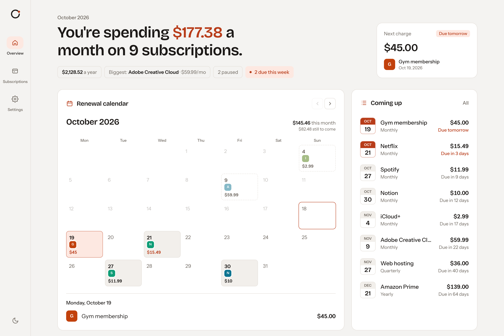
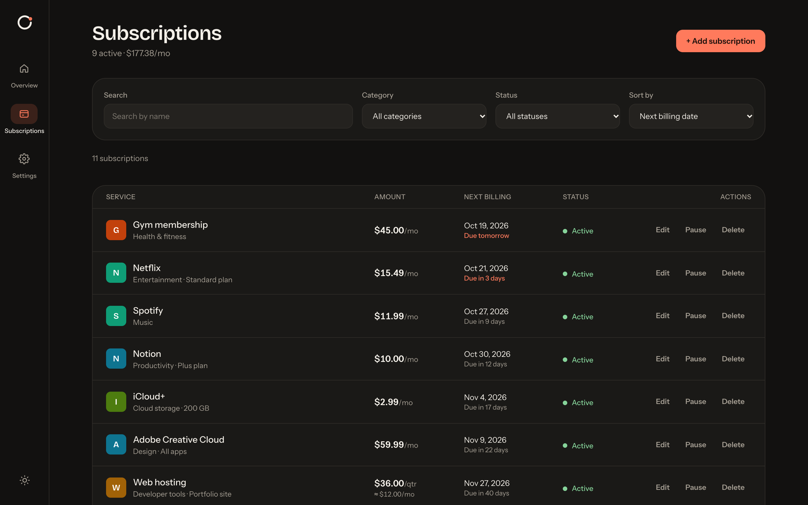
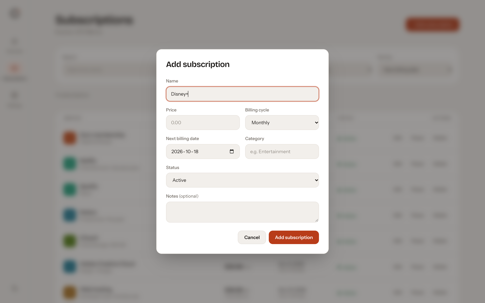
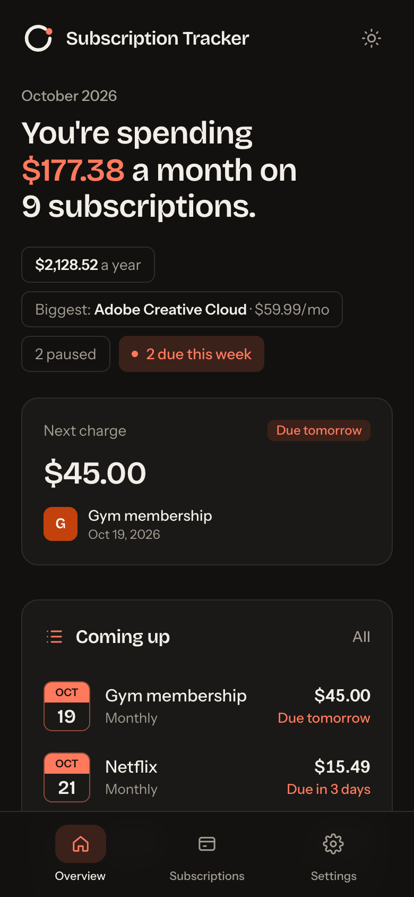

<h1>
  <picture>
    <source media="(prefers-color-scheme: dark)" srcset="docs/logo-dark.svg">
    
  </picture>
  Subscription Tracker
</h1>

Track recurring payments and see monthly and yearly spend at a glance.

A frontend-only app that answers two questions: *what do my subscriptions cost each month*, and *what gets charged next*. Everything runs in the browser, with no account and no backend.

<!-- Add the deployed URL here once it's live, e.g. **[Live demo →](https://your-app.vercel.app)** -->


<!-- GitHub shows the screenshot that matches the reader's own light or dark theme. -->
<picture>
  <source media="(prefers-color-scheme: dark)" srcset="docs/screenshots/dashboard-dark.png">
  
</picture>

| Subscriptions | Add a subscription | Phone |
| --- | --- | --- |
|  |  |  |

## Features

- **Renewal calendar.** Every charge appears on the day it lands, including ones already made earlier this month. You can look up to a year ahead and click a day to see what's due.
- **Spend at a glance.** Monthly and yearly totals, the biggest subscription, and anything due this week. Paused subscriptions are left out of every total.
- **Coming up.** The next charges in date order, highlighted when they're due within 7 days.
- **Month by month.** A 12-month projection built from each billing cycle, so yearly renewals show up in the month they land.
- **Spend by category.** Monthly cost per category, with each category keeping the same colour across charts.
- **Manage subscriptions.** Add, edit, pause, resume and delete, with inline validation and a confirmation step before deleting. Search by name, filter by category and status, and sort by price, name or next billing date.
- **Back up and restore.** Export everything to JSON and import it on another device. Files are checked for the right format before anything is replaced.
- **Light and dark.** Follows your system setting on first visit, remembers your choice, and never flashes the wrong theme on load.
- **Ready on first visit.** Realistic demo data loads the first time, so there's something to explore straight away.

## Technical highlights

- **Correct date math.** Billing dates are calendar dates, calculated in UTC so time zones and daylight saving can't shift them. Month-end billing doesn't drift: Jan 31 → Feb 28 → Mar 31. Past dates roll forward by whole billing cycles.
- **localStorage without hydration errors.** Data is read through React's `useSyncExternalStore`, so the server render and the first client render always match. Stored data is versioned and validated on load, and changes sync across open tabs.
- **No flash of the wrong theme.** A tiny inline script sets the saved theme before the first paint. With no saved choice, CSS follows `prefers-color-scheme` on its own.
- **Pure logic, thin UI.** Pricing, renewals, projections, search, validation and import parsing are pure functions in `src/lib`, unit tested with Vitest, including the edge cases (month ends, leap years, paused subscriptions, malformed imports). Components only render.
- **Accessible charts.** The chart palette is checked for colour-blind separation in both themes. Every value is also available as text (legends, labels and hidden tables), so nothing depends on colour or hover alone.
- **Keyboard and screen reader support.**
  - The modals use the native `<dialog>` element, so focus is trapped, Escape closes them and focus returns to where you were.
  - Form errors are linked to their fields.
  - In the calendar, Tab moves between charge days only, not every date.
- **Fully static.** Built with the Next.js 16 App Router with Cache Components, and every route is prerendered.

## Tech stack

- [Next.js](https://nextjs.org) 16 (App Router) and TypeScript
- [Tailwind CSS](https://tailwindcss.com) 4
- [Recharts](https://recharts.org) 3
- [Vitest](https://vitest.dev)

## Getting started

```bash
npm install
npm run dev
```

Then open [http://localhost:3000](http://localhost:3000). Demo data loads on the first visit. To start over, clear the site's storage in your browser's developer tools.

| Command | Description |
| --- | --- |
| `npm run dev` | Start the dev server |
| `npm run build` | Create a production build |
| `npm run start` | Serve the production build |
| `npm run lint` | Run ESLint |
| `npm test` | Run the unit tests once |
| `npm run test:watch` | Run the tests in watch mode |

## Project structure

```
src/
  app/          Routes: overview, subscriptions, settings
  components/   UI, grouped by page (dashboard, subscriptions, settings) plus shared ui/ and layout/
  hooks/        useSubscriptions (storage-backed store), useTheme, useToday
  lib/          Pure, tested logic: dates, pricing, renewals, charges, forecast, validation, import/export
  data/         Demo subscriptions and category suggestions
  types/        The Subscription type
```

## Roadmap

- **Choose your currency.** One app-wide setting instead of US dollars only.
- **Renewal reminders.** Optional browser notifications a few days before a charge.
- **Free trials.** Track when a trial ends and flag it before it turns into a charge.
- **Calendar export.** Add upcoming renewals to Google or Apple Calendar with an `.ics` file.

## Notes

- **All data stays in your browser's localStorage.** Clearing site data removes it, so use **Settings → Export JSON** to keep a backup.
- **Amounts are shown in US dollars** (see the roadmap).
